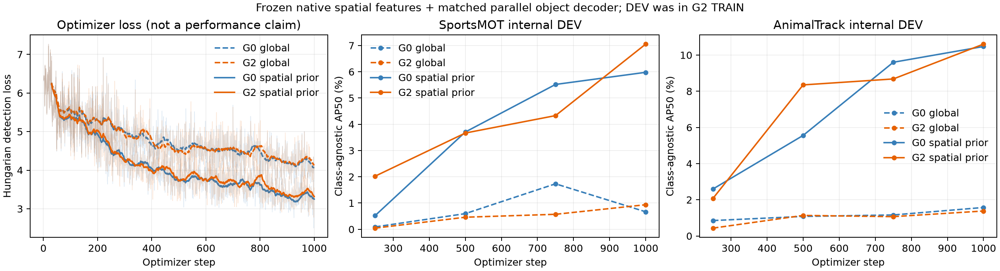

# Real GPU training complete; full-video evaluation pending

**All four frozen-backbone readouts completed1,000 optimizer steps. Complete video metrics and the final research decision are still pending.** The old full evaluation remains paused.

Each trial:3,975,829 trainable head parameters,428,482,048 frozen native vision/projector parameters,4images/step,4,000 exposures /2,400 distinct TRAIN images; same seed42, data order, optimizer, learning-rate schedule, query count and parameter initialization. Native G2 final18227 SHA and G0 SHA are recorded with each checkpoint. The spatial prior adds no parameters.

|Readout/model|Head steps|Best sampled-DEV step|Best macro AP50 on480 internal-DEV frames|GPU|Peak allocated MiB|
|---|---:|---:|---:|---:|---:|
|global/g0|1000|750|1.4463%|6|3010.7|
|global/g2|1000|1000|1.1576%|4|3010.7|
|spatial_prior_v2/g0|1000|1000|8.2262%|7|3010.7|
|spatial_prior_v2/g2|1000|1000|8.8295%|1|3010.7|

These480 DEV frames come from20 benchmark sequences /12 source groups within original TRAIN and were previously seen by G2 fine-tuning. These AP values are training/development diagnostics, not independent G2 generalization results or dataset-wide benchmark scores. Native final G2 has no per-box confidence and no comparable AP.

Full8,370-frame internal-DEV evaluation and the frozen1,607-frame/6-video native-cache comparison continue. Head selection and thresholds use only internal DEV. No external model metrics have been used to change architecture, optimizer or thresholds. The spatial-prior plan was frozen before external head outputs were observed.

All best/last checkpoint paths and exact SHA256, actual model/source/GPU identities, sampled-DEV histories and parameter counts are in TRAINING_COMPLETE_EVAL_PENDING_RECEIPT.json. Optimizer exposure trace is in OPTIMIZER_DATA_EXPOSURE.json. Original global-query weak results are retained; all four curves are shown in PILOT_CURVES.png. No identity training or G2 parameter update occurred.

Native vision/projector provenance, image-only leakage checks, GPU gradient/restore smoke and bounded two-image TRAIN-overfit capacity evidence are in SPATIAL_FEATURE_AUDIT.md. Source alias, density/visibility and TAO/Refer label-boundary audits are in DATASET_PROTOCOL.md and associated JSON. Clean-public-checkout GPU inference and genuine detection-loss-to-projector gradient verification are implemented for final delivery; they have not yet been executed from the final published snapshot.
